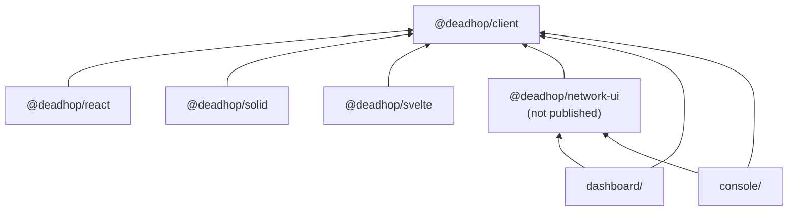

<div align="center">

<picture>
  <source media="(prefers-color-scheme: dark)" srcset="https://deadhop.run/docs/mark-fog.svg">
  
</picture>

# deadhop JavaScript

Pay buttons and invoices for your app, and the dashboard and console for running a
[deadhop](https://deadhop.run) service.

[](https://www.npmjs.com/package/@deadhop/client)
[](https://github.com/deadhop/js/actions/workflows/ci.yml)
[](#develop)
[](LICENSE)

</div>

A deadhop service has no web address. Your page reaches it through Nostr relays, with nothing
but the service's public key and a relay it listens on. These packages handle that
connection, the proof of work a public invoice needs, and the invoice's life from
*awaiting payment* to *paid*.

## Add payments to your app

```sh
npm install @deadhop/client @deadhop/react   # or @deadhop/solid, @deadhop/svelte
```

```tsx
import { createDeadhop } from '@deadhop/client';
import { PayButton } from '@deadhop/react';   // or @deadhop/solid, @deadhop/svelte, @deadhop/svelte/svelte4

const deadhop = createDeadhop({ serverPubkey: 'npub1…', relays: ['wss://relay.example.com'] });
<PayButton client={deadhop} amount={5000} onPaid={(inv) => console.log(inv.id)} />;
```

Either the browser creates the invoice (the service allows public invoicing, and the browser
mines the proof of work), or your back end creates it with an operator key and the page only
shows it. Either way, fulfil an order only after your back end has checked the invoice with
`getInvoice(id)`.

| Package | Where | What it is |
| --- | --- | --- |
| [`@deadhop/client`](packages/client) | npm, JSR | Connection, validation, proof of work, the headless checkout, QR codes. Works with any framework, or none. |
| [`@deadhop/react`](packages/react) | npm, JSR | `PayButton`, `InvoiceForm`, `Invoice` and `useCheckout` for React 18 and 19 |
| [`@deadhop/solid`](packages/solid) | npm, JSR | The same for Solid 1.8+ |
| [`@deadhop/svelte`](packages/svelte) | npm | The same for Svelte 5, and Svelte 4 at `@deadhop/svelte/svelte4` |

Guides: [Add payments to your app](https://deadhop.run/docs/integrate.html), with one each for
[React](https://deadhop.run/docs/integrate-react.html),
[Solid](https://deadhop.run/docs/integrate-solid.html),
[Svelte 5](https://deadhop.run/docs/integrate-svelte5.html),
[Svelte 4](https://deadhop.run/docs/integrate-svelte4.html),
[no framework](https://deadhop.run/docs/integrate-javascript.html) and
[your back end](https://deadhop.run/docs/integrate-backend.html).

## The dashboard and the console

The dashboard is the service's web front: customers pay invoices there, and operators sign in
with a Nostr key (a browser extension or a pasted secret key) to manage the service. It is a
static page, so it can be hosted anywhere; it reads the service's key and relays from a
`config.json` next to it ([Host the dashboard](https://deadhop.run/docs/dashboard.html)).

<p align="center">
  
  
</p>
<p align="center"><sub>The operator's invoices, and a customer's paid invoice on a phone. Regtest, not a live shop.</sub></p>

The console is a standalone page for one part of that: a service's network settings (relays,
proxies, routing rules), for a deadhop service or an lnaddr node or gateway. It signs in with
the same operator keys. See [console/README.md](console/README.md).

## How the packages fit together



`@deadhop/network-ui` holds the network views the dashboard and the console share, which is
why all three live in this repository.

## Develop

Requirements: Node 24, Deno 2 (for the JSR dry run) and [`just`](https://github.com/casey/just).

```sh
just install    # the npm workspace and the Svelte 4 test project
just test       # unit tests; 100% of statements, branches, functions and lines enforced
just check      # tsc and svelte-check
just packages   # pack, install into fresh React, Solid, Svelte 5 and Svelte 4 apps, publint, attw, JSR dry run
just dashboard  # build the dashboard and serve it at http://127.0.0.1:4173
just e2e        # real payments on regtest, in Chrome (see below)
```

The end-to-end tests pay real regtest invoices through a real relay, Fulcrum and the service.
They need the regtest stack from [deadhop/stack](https://github.com/deadhop/stack): clone it,
run `just clone` there (this repository lands in its `js/`), then `just up`, `just server` and
`just e2e`. Set `DEADHOP_WORKSPACE` if the stack is somewhere else.

```
.
├── brand/                fonts and favicon, copied from deadhop/brand
├── console/              the network console (static page)
├── dashboard/            the dashboard (Docker image, or any static host)
├── fixtures/             the routing contract and two service snapshots, copied from deadhop/server
├── packages/
│   ├── client/           @deadhop/client
│   ├── e2e/              every framework's PayButton paying on regtest (not published)
│   ├── network-ui/       the shared network views (not published)
│   ├── react/            @deadhop/react
│   ├── shared/           styles, test fixtures and build helpers (not published)
│   ├── solid/            @deadhop/solid
│   └── svelte/           @deadhop/svelte
├── scripts/              check-packages.sh, publish-npm.sh, set-version.sh
├── deno.json             the Deno workspace, for JSR
├── justfile
└── package.json          the npm workspace
```

`brand/` and `fixtures/` are copies: change the originals first (see the README in each).

## Release

The four published packages share one version:

```sh
scripts/set-version.sh X.Y.Z   # then commit, push, and push the tag vX.Y.Z
```

`.github/workflows/publish.yml` tests, then publishes to npm and to JSR in separate jobs, with
trusted publishing (no registry tokens in the repository). Versions already on a registry are
skipped, so a failed run can be retried by hand.

## Agent skills

This repository ships [agent skills](https://deadhop.run/docs/skills.html) for Claude Code,
Codex, Cursor and other agents that read `SKILL.md`:

```sh
npx skills add deadhop/js
```

| Skill | Use it to |
| --- | --- |
| `deadhop-js-integrate` | add pay buttons, invoice forms and invoices to an app, and check payments on the back end before fulfilling |
| `deadhop-js-dashboard` | host the dashboard and the network console, write `config.json`, and sign in as an operator |
| `deadhop-js-develop` | contribute here: the gates, 100% coverage, the copied fixtures and brand files, end-to-end tests, releases |

Install one with `--skill <name>`. Every deadhop skill is listed on
[Agent skills](https://deadhop.run/docs/skills.html).

## Contributing

Issues and pull requests are welcome here. CI runs `just test`, `just check` and
`just packages` on every pull request. Doc changes go to
[deadhop/site](https://github.com/deadhop/site).

## License

[MIT](LICENSE).
